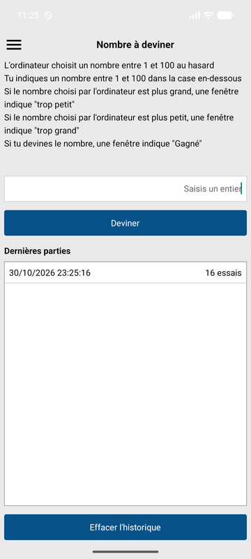
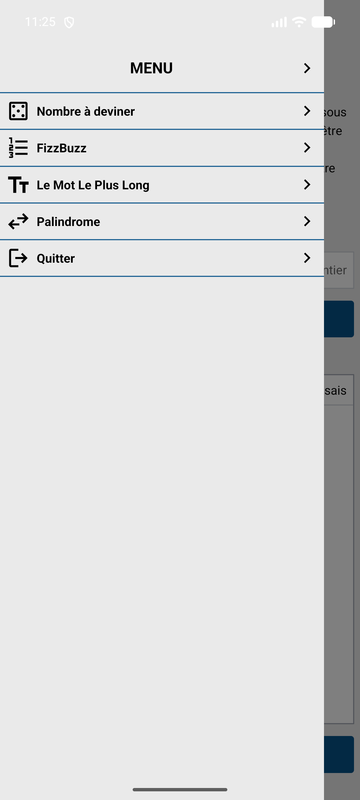
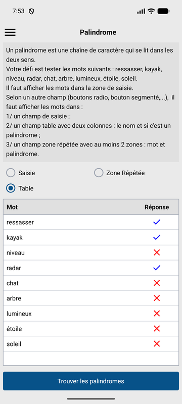

# MesDefis : React Native pour développeurs WinDev

Tu sais programmer en WinDev ou WinDev Mobile, et tu n'as jamais touché à React Native ? Ce dépôt est le code du cours vidéo de la chaîne **DevNico**, le pendant React Native du cours WinDev Mobile Débutant.

En 10 modules, soit environ 4 h de cours, tu construis une vraie application Android. Chaque notion part de ce que tu connais déjà en WinDev, puis montre ce qui change.

<p align="center">
  
  
  
</p>

## L'application

**MesDefis** réunit quatre petits défis de programmation : Nombre à deviner, Mot le plus long, FizzBuzz et Palindrome. On passe de l'un à l'autre par un menu coulissant. Les parties gagnées sont enregistrées dans une base SQLite, et l'application finit en APK installé sur ton téléphone.

## Le programme

Chaque module a une leçon, puis un challenge à faire seul. Les durées sont celles du texte parlé : les vidéos montées seront un peu plus longues.

| # | Tu apprends | Ton challenge | Durée |
|---|---|---|---|
| 01 | Installer les outils et lancer l'app sur ton téléphone | Changer le texte d'accueil | 15 min |
| 02 | Lire un projet : des fichiers au lieu d'un éditeur | Retrouver 3 éléments de l'explorateur WinDev | 15 min |
| 03 | Écrire un premier écran avec des composants et du JSX | Mot le plus long, écran statique | 22 min |
| 04 | Mettre en page avec Flexbox et NativeWind | Mot le plus long, fidèle à la maquette | 30 min |
| 05 | Rendre un écran vivant avec `useState` | Compter les essais | 31 min |
| 06 | Créer des composants réutilisables avec des props | Migrer les 2 autres écrans | 26 min |
| 07 | Afficher des listes avec `FlatList` | Mot le plus long jouable | 29 min |
| 08 | Ajouter un menu coulissant avec Expo Router | Ligne « Quitter » | 21 min |
| 09 | Garder les données avec expo-sqlite | Effacer l'historique | 35 min |
| 10 | Générer l'APK avec EAS Build | Version 1.0.1 | 15 min |

## Ce que tu connais déjà

| En WinDev | En React Native |
|---|---|
| Une fenêtre ou un plan | Un écran, c'est-à-dire un composant |
| `OuiNon` | `Alert`, avec deux boutons |
| Un tableau associatif | Un tableau d'objets |
| Une fenêtre coulissante | Un Drawer |
| Lire un fichier HFSQL enregistrement par enregistrement | Recevoir tout le résultat d'une requête SQLite |
| Générer l'APK sur ton PC, avec Gradle | Le générer sur les serveurs d'Expo, avec EAS Build |

## Suivre le cours avec ce dépôt

Tu suis le cours depuis le module 01 ? Crée ton projet comme dans la vidéo, et continue dedans du début à la fin.

Tu veux prendre le cours en route ? Chaque module a deux tags :

- `module-XX-lecon` : le projet à la fin de la leçon, c'est le départ du challenge ;
- `module-XX` : le projet à la fin du challenge, c'est la correction et le départ du module suivant.

Par exemple, pour commencer le module 05 :

```bash
git clone https://github.com/lazar360/mesdefis mesdefis
cd mesdefis
git switch -c mon-module-05 module-04
npm install
npx expo start
```

Scanne ensuite le QR code avec l'application Expo Go.

Pour voir la correction d'un challenge, compare ton travail au tag du module :

```bash
git diff module-05
```

## Ce qu'il te faut

- Node.js 22.13 ou plus récent, et Git ;
- un éditeur de code, par exemple VS Code ;
- un téléphone Android avec Expo Go ;
- un compte Expo, gratuit, pour le module 10.

Le projet utilise Expo SDK 58. Une version d'Expo Go n'ouvre qu'un seul SDK : si Expo Go refuse le projet, commence par vérifier ce point.
